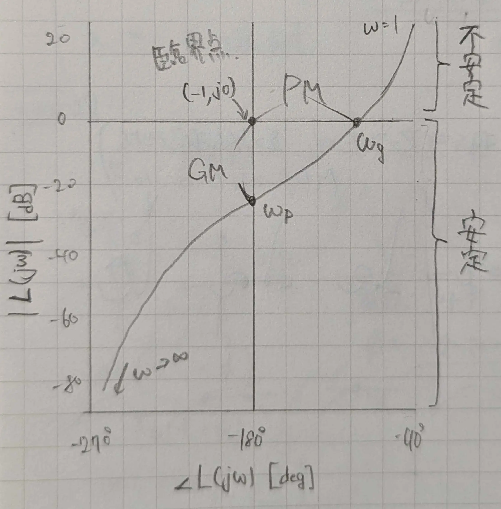

# ゲイン位相線図（Magnitude-Phase Plot）
> 伝達関数 $L(j\omega)$ の大きさ $|L(j\omega)|$ を縦軸，位相 $\angle L(j\omega)$ を横軸にとり，$\omega$ をパラメータとしてその軌跡を描いた周波数応答の図．

例として，次の伝達関数をプロットした．  

$$
L(s) = \frac{10}{s(1 + 0.2s)(1 + 0.02s)}
$$

## 読み取れること
- 臨界点 $(-1, j0)$：$0 \; \mathrm{dB}$ 軸と $-180 °$ 軸の交点
- 位相交差 $\omega_p$：軌跡が $-180 °$ 軸と交わる点
- ゲイン交差 $\omega_g$：軌跡が $0 \; \mathrm{dB}$ 軸と交わる点
- [ゲイン余裕](_Word/gain-margin.md) $\mathrm{GM}$：位相交差から臨界点までの垂直距離（位相交差が $0 \; \mathrm{dB}$ より下にあれば安定側）
- [位相余裕](_Word/phase-margin.md) $\mathrm{PM}$：ゲイン交差から臨界点までの水平距離（ゲイン交差が $-180 °$ 軸より右にあれば安定側）

## ゲイン位相線図の利点
> ループゲインや位相を変えたときの軌跡の挙動が，平行移動 と単純になるから  

| 平行移動の向き | 減少  | 増加  |
| :-----: | :-: | :-: |
|   位相    |  ←  |  →  |
|   ゲイン   |  ↓  |  ↑  |

※無駄時間 $T_d$ を含む場合は，各点に $-\omega T_d \times 180° / \pi$ の位相を加える．  
ナイキスト線図では，ループゲインを変えると軌跡の形が変わるので不便．

## ボード線図との違い
- ボード線図：ゲイン線図と位相線図の2枚組．横軸はどちらも周波数．
- ゲイン位相線図：ゲインと位相を互いの座標軸都市，1枚の平面に描く．

## ニコルス線図との関係
- 同じ座標平面に，等M軌跡をプロットしたものを台紙として，ゲイン位相線図をプロットして使う．
- ボード線図からは読み取れない「閉ループの共振ピーク」，「共振周波数」，「帯域幅」を図から読みとることができる．