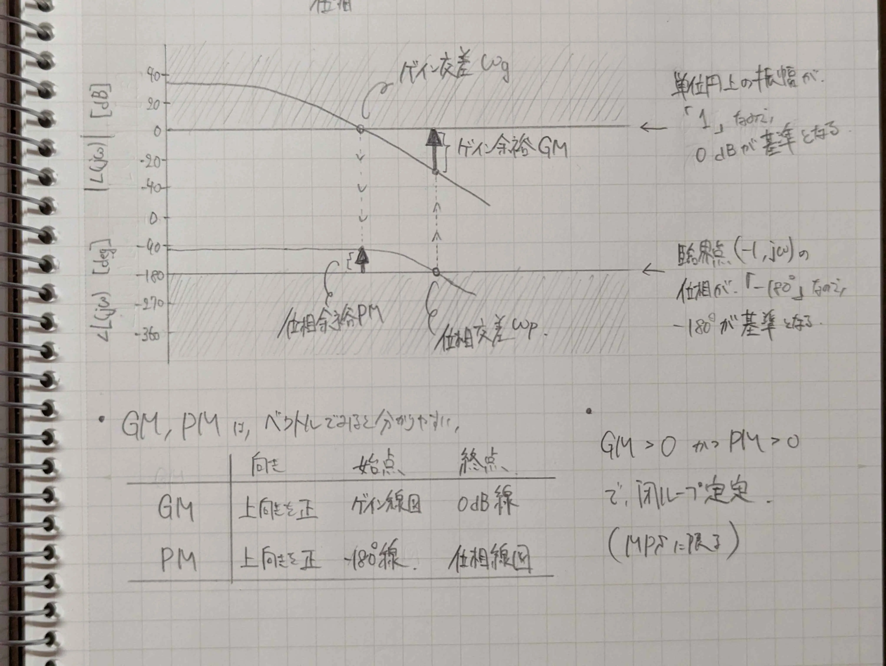
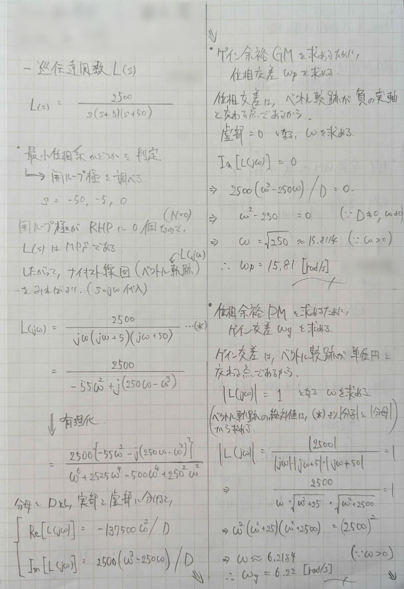
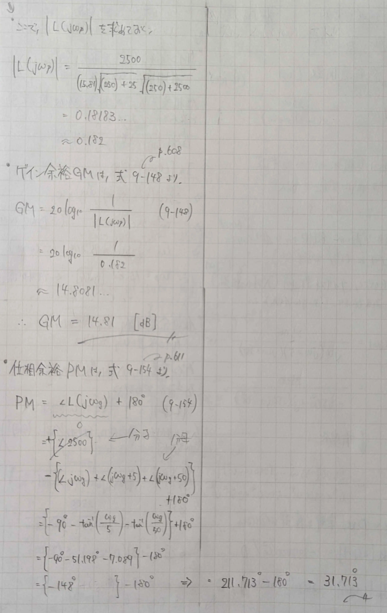

# 位相余裕（Phase Margin, PM, $\phi_m$）
> 開ループ伝達関数のゲインが $0 \: \mathrm{dB}$ となるゲイン交差周波数 $\omega_{cg}$ において，位相が $- 180 \: \mathrm{deg}$ からどれだけ余裕があるかを表す安定度指標．

## 性質
- 位相余裕の大きさは，システムがどの程度の位相遅れまで安定性を保てるか？を示す．
- 位相余裕が正：閉ループ安定
- 位相余裕が0：[安定限界](_Word/marginal-stability.md)
- 位相余裕が負：不安定
## 定義式[^1]
位相余裕 $\phi_m$ は，ゲイン曲線が $0 \: \mathrm{dB}$ となるときの周波数における，一巡周波数応答の位相と $- \pi$ との差である．ゲイン交差周波数 $g_{cg}$ を用いて，  
$$
\phi_m = \theta (\omega_{cg}) - (- \pi)
$$

↑$- \pi$   を基準にしている

## 推奨値
- サーボ系：40 ~ 65度
- プロセス制御：15 ~ 70度  
## 位相余裕改善手法
- 位相進み要素など  

位相余裕とゲイン余裕合わせて安定余裕と呼ぶ．

## 読み取り
### ナイキスト線図上では，
位相余裕 $\phi_m$ は，ベクトル軌跡が単位円と交わる点での偏角と，$-180 \: \mathrm{deg}$ の差  
言い換えると，ベクトル軌跡で，一巡周波数応答のゲインが $1$ になったときに，位相が $-\pi$ になるまでにどのくらい余裕があるか？  
↑反時計回りを正方向としている
### ボード線図上では，
位相余裕 $\phi_m$ は，ゲイン線図が $0 \: \mathrm{dB}$ を横切る周波数 $\omega_{cg}$ を読み取り，その周波数での位相線図の値と $-180 \: \mathrm{deg}$ の差  
★$-180 \: \mathrm{deg}$ の理由は，臨界点 $(-1, j0)$ が原点から見て$-180 \: \mathrm{deg}$ にあるから．

## 例題
> 一巡伝達関数 $L(s)$ を次式で与える．ゲイン余裕と位相余裕を求める．

$$
L(s) = \frac{2500}{s(s+5)(s+50)}
$$

### 手順
(ゲイン余裕も一緒に求めている)
1. 最小位相系か判別（開ループ極を求める）
2. 周波数伝達関数(ベクトル軌跡)を式で求める（$s = j\omega$ 代入）
	- 有理化し，実部と虚部に分けておく  
**＜ゲイン余裕＞**  
3. 位相交差 $\omega_p$ を求める　→　虚部 $= 0$ 
4. $|L(j\omega_p)|$ を求める
5. 公式適用　→　$\mathrm{GM} = - 20 \log (|L(j\omega_p)|)$  
**＜位相余裕＞**  
6. ゲイン交差 $\omega_g$ を求める　→　 $|L(j\omega)| = 1$ 
7. $\angle L(j\omega_g)$ を求める
	- 分子は+，分母は-，積は和になる
	- $\angle (ja + b) = \tan^{-1} (a/b)$
8. 公式適用　→　$\mathrm{PM} = \angle L(j\omega_g) + 180 ^\circ$  

[^1]: 森泰親．演習で学ぶ現代制御理論．新装版，森北出版（2014），p.105．