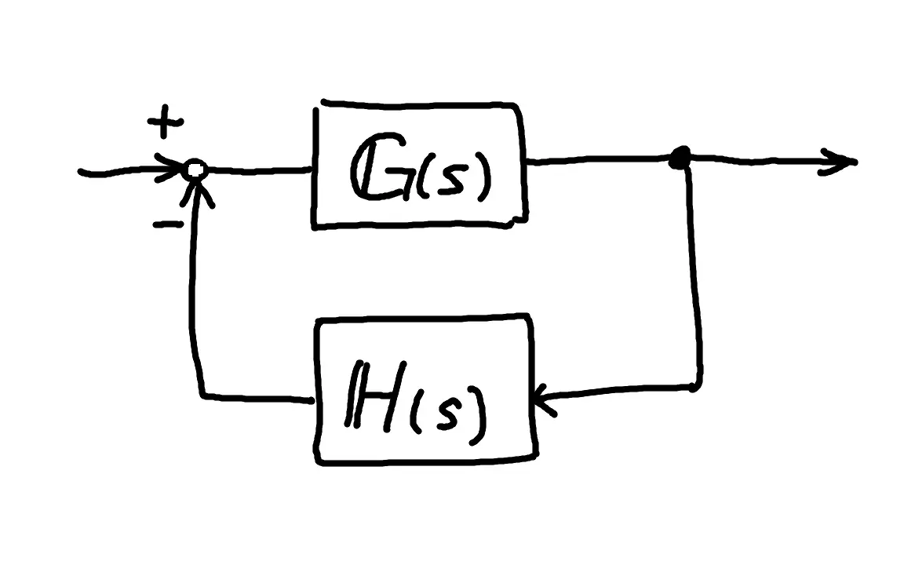

# 直結フィードバック系（Unity Feedback System）
> フィードバック経路の伝達関数が $H(s) = 1$ であり，出力がそのまま目標値と比較される閉ループ系．

**Fig. 1**　閉ループ系のブロック線図

## 一般的な閉ループ伝達関数

$$
\boldsymbol{M}(s) = \frac{\boldsymbol{G}(s)}{1 + \boldsymbol{G}(s)\boldsymbol{H}(s)} = \frac{\boldsymbol{G}(s)}{1 + \boldsymbol{L}(s)}
$$
## 直結フィードバック系の閉ループ伝達関数
$\boldsymbol{H}(s) = 1$ なので

$$
\boldsymbol{M}(s) = \frac{\boldsymbol{G}(s)}{1 + \boldsymbol{G}(s)}
$$

## 直結であるならば...
- 一巡伝達関数 $\boldsymbol{L}(s)$  と前向き経路の伝達関数 $\boldsymbol{G}(s)$  と一致する
	- $\boldsymbol{L}(s) = \boldsymbol{G}(s)\boldsymbol{H}(s)$　→　$\boldsymbol{L}(s) = \boldsymbol{G}(s)$
	- ※厳密には，一巡伝達関数は，開ループ伝達関数は常に一致するとは限らない
- ブロック線図の加算点の信号が，目標値 $R$ と出力 $Y$ の差そのものとなる
	- 偏差 $E = R - Y$

## 文字の定義

| 文字                  | 名前                      | 定義／メモ                                                                                                                                                                        |
| ------------------- | ----------------------- | ---------------------------------------------------------------------------------------------------------------------------------------------------------------------------- |
| $\boldsymbol{G}(s)$ | 前向き伝達関数 （前向き経路の伝達関数） | ブロック線図の直線だけの部分   $\boldsymbol{G}(s) = \boldsymbol{C}(s)\boldsymbol{P}(s)$   として，コントローラとプラントを1まとまりで見ることが多い（両者が直列の関係の場合）                                                 |
| $\boldsymbol{H}(s)$ | フィードバック伝達関数             | ブロック線図の閉ループだけの部分   「直結」ならばここが 1 ということ                                                                                                                                     |
| $\boldsymbol{M}(s)$ | 閉ループ伝達関数                | 閉ループ部分も考慮した全体の伝達関数   暗記法：   「いちたすぐるっと分のまっすぐ」 ←負帰還   「いちひくぐるっと分のまっすぐ」 ←正帰還                                                                                           |
| $\boldsymbol{L}(s)$ | 一巡伝達関数 （開ループ伝達関数）    | ループを1か所で切り開き，そこから信号を入れて輪を一周させたときに通る，全ての要素の積   「ぐるっと」の部分   $\boldsymbol{L}(s) = \boldsymbol{G}(s)\boldsymbol{H}(s)$   どこで切っても通る要素は同じなので，入出力に無関係．   ★ループそのものの性質を表す |

## メモ
- 直結フィードバック系であることが前提　である解析手法があるので注意．
	- 例）等M軌跡，等N軌跡，ニコルス線図